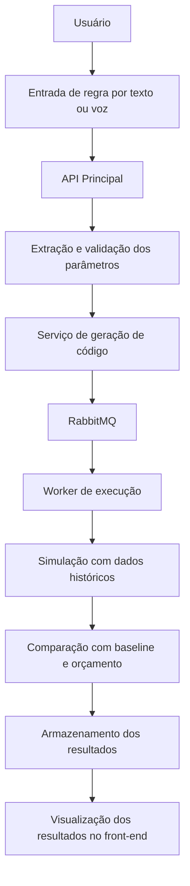

# 🧠 Synapse | API 6º Semestre — FATEC

🔗 **Repositório do Projeto (Equipe):** [Acessar GitHub](https://github.com/Titus-System/synapse)

## 📌 Sobre o Projeto

O **Synapse** é uma aplicação web desenvolvida com base na metodologia **API (Aprendizagem por Projetos Integrados)** durante o sexto semestre do curso de Análise e Desenvolvimento de Sistemas da **FATEC São José dos Campos — Prof. Jessen Vidal**, pela equipe **Titus System**.

O principal objetivo da solução é **estruturar, documentar e simular regras de negócio relacionadas ao comissionamento de vendas**, utilizando inteligência artificial para auxiliar na interpretação das informações fornecidas pelos usuários e na avaliação de seus impactos financeiros.

A proposta permite transformar descrições de regras de negócio em estruturas processáveis, executar simulações utilizando dados históricos e comparar os resultados com um cenário de referência, denominado **baseline**.

A plataforma contempla funcionalidades relacionadas à entrada de regras por texto e voz, geração de código assistida por inteligência artificial, avaliação orçamentária, sugestões de adaptação, histórico de processamentos e visualização detalhada dos resultados.

Dessa forma, o Synapse busca apoiar a tomada de decisões empresariais, permitindo avaliar diferentes cenários de comissionamento antes da aplicação das regras em um ambiente operacional.

## 🏢 Parceiro de Negócios (Cliente)

O projeto foi desenvolvido a partir de um desafio proposto pela **Dom Rock**, representada por **Luiz Otavio e Andre Almeida**.

O desafio apresentado está relacionado à dificuldade de registrar, organizar, documentar e manter regras de negócio corporativas que sofrem alterações frequentes, especialmente aquelas associadas ao comissionamento de vendas.

Essas alterações podem ocorrer em decorrência de novas políticas comerciais, campanhas de incentivo, metas de vendas e estratégias organizacionais.

A ausência de mecanismos adequados para estruturar essas informações pode ocasionar dificuldades de manutenção, inconsistências nos cálculos, perda de conhecimento organizacional e problemas de rastreabilidade.

Além disso, a implementação de novas regras exige a avaliação de seus possíveis impactos financeiros antes de sua aplicação.

Nesse contexto, o Synapse busca centralizar a definição das regras, automatizar parte de sua interpretação e disponibilizar recursos de simulação e análise dos resultados.

## 🚀 Funcionalidades e Demonstração

O escopo geral do projeto contempla as seguintes funcionalidades:

- 📝 **Entrada de Regras por Texto:** definição de regras de comissionamento por meio de descrições textuais e parâmetros estruturados.

- 🎙️ **Captura e Transcrição de Voz:** conversão das informações fornecidas por áudio em texto para processamento.

- 🤖 **Extração de Regras com Inteligência Artificial:** interpretação das informações fornecidas pelos usuários e identificação dos parâmetros necessários à simulação.

- ⚙️ **Geração de Código Assistida por IA:** transformação das regras de negócio em estruturas executáveis para realização das simulações.

- 📊 **Simulação de Comissionamento:** aplicação das regras sobre dados históricos para avaliar os possíveis resultados financeiros.

- 📈 **Comparação com Baseline:** comparação dos resultados simulados com um cenário de referência.

- 💰 **Avaliação Orçamentária:** análise dos resultados considerando o orçamento informado pelo usuário.

- 🔄 **Sugestões de Adaptação:** apoio à revisão das regras e metas quando os resultados apresentam incompatibilidades com os parâmetros estabelecidos.

- 🗂️ **Histórico de Regras:** consulta e gerenciamento das regras salvas e arquivadas.

- 🔎 **Detalhamento dos Resultados:** apresentação das comissões por colaborador, com filtros e paginação.

- 🔐 **Autenticação e Controle de Acesso:** gerenciamento das sessões e proteção dos recursos da aplicação por meio do Keycloak.

- 📋 **Auditoria e Explicabilidade:** recursos relacionados à rastreabilidade e à compreensão dos processamentos, previstos no escopo da terceira sprint.

> ⚠️ As funcionalidades apresentadas correspondem ao escopo geral do projeto. As entregas visuais parciais e as funcionalidades previstas para etapas posteriores são identificadas separadamente das integrações efetivamente implementadas.

### 🛠️ Arquitetura do Sistema

O **Synapse** foi estruturado utilizando uma arquitetura distribuída, com separação das responsabilidades entre a interface web, a API principal, os serviços de inteligência artificial, os componentes responsáveis pela execução das simulações e os mecanismos de persistência e comunicação.

Essa organização possibilita distribuir as responsabilidades do processamento entre diferentes componentes, permitindo que as etapas de interpretação, geração e execução das regras sejam tratadas de forma independente.

| Componente | Responsabilidade | Tecnologias principais |
|---|---|---|
| Front-end | Entrada das regras, formulários, histórico, acompanhamento dos processamentos e visualização dos resultados. | Vue.js, TypeScript, Vite e Tailwind CSS |
| API Principal | Gerenciamento dos fluxos, autenticação, persistência e integração com a interface. | Java e Spring Boot |
| Serviço de Geração de Código | Extração, validação e transformação das regras de negócio com apoio de inteligência artificial. | Python, FastAPI e LangGraph |
| Worker de Execução | Execução isolada do código gerado e realização das simulações. | Python e Docker |
| Mensageria | Comunicação assíncrona entre os serviços responsáveis pelo processamento. | RabbitMQ |
| Persistência | Armazenamento das regras, registros de execução e resultados das simulações. | PostgreSQL |
| Autenticação | Gerenciamento de identidades, sessões e controle de acesso. | Keycloak e JWT |
| Processamento de Voz | Transcrição das informações fornecidas pelos usuários por meio de áudio. | Deepgram |

A comunicação entre os componentes utiliza mecanismos síncronos e assíncronos, conforme as necessidades de cada etapa do processamento.

O **RabbitMQ** é utilizado para organizar a comunicação assíncrona entre os serviços, permitindo distribuir atividades relacionadas à geração de código e à execução das simulações.

A interface acompanha os estados do processamento por meio de **Server-Sent Events (SSE)**, possibilitando atualizar as informações apresentadas ao usuário durante a execução das atividades.

O código produzido pelos serviços de inteligência artificial é tratado como código não confiável e executado em contêineres isolados, com restrições de rede e recursos computacionais.

Essa abordagem busca reduzir os riscos associados à execução de código gerado automaticamente, embora o isolamento não constitua uma garantia absoluta de segurança.

### 🔄 Fluxo Geral de Processamento

O fluxo representa uma visão simplificada da arquitetura e das principais etapas relacionadas à definição, ao processamento e à simulação das regras de negócio.

[🔗 Consultar a documentação da arquitetura](https://github.com/Titus-System/synapse/blob/main/docs/ARCHITECTURE.md)

### 🖥️ Demonstração

Confira a demonstração da **Sprint 2**, disponibilizada no repositório oficial da equipe:

https://github.com/user-attachments/assets/5c50876b-64d8-44c6-9050-4d9dfb758745

## 💻 Tecnologias Utilizadas

As tecnologias e ferramentas abaixo correspondem ao conjunto de recursos utilizados pela equipe no desenvolvimento do projeto.

Minha atuação individual e o nível de autonomia na utilização dessas tecnologias são detalhados nas seções de contribuições pessoais e competências técnicas.

### ⚙️ Back-end e Inteligência Artificial

  
  
  
  
  
  

### 🖥️ Front-end

  
  
  
  
  
  

### 🗄️ Persistência e Mensageria

  
  
  

### 🔐 Autenticação e Infraestrutura

  
  
  

### 🧪 Testes e Qualidade

  
  
  

### 🛠️ Versionamento, Metodologia e Design

  
  
  
  

## 📌 Contribuições Pessoais

Atuo como **desenvolvedora full-stack** no Dev Team da equipe **Titus System**, participando da construção de diferentes componentes do Synapse.

Minha atuação abrange o desenvolvimento das interfaces, a integração com os serviços do back-end, a implementação de mecanismos de autenticação, o processamento de informações fornecidas por voz e a integração de funcionalidades relacionadas à inteligência artificial.

Essa participação possibilitou ampliar minha compreensão sobre arquiteturas distribuídas, contratos de comunicação, processamento assíncrono e desenvolvimento de soluções empresariais.

### 🖥️ Desenvolvimento Front-end

Na camada de apresentação, participei da estruturação inicial da aplicação utilizando **Vue.js, TypeScript, Vite e Tailwind CSS**, incluindo a organização das rotas, dos componentes, do gerenciamento de estado e da integração com o ambiente Docker.

Entre minhas principais contribuições, destaca-se o desenvolvimento do formulário destinado à definição das regras de comissionamento, contemplando a validação dos parâmetros, da competência e do orçamento informado.

Também trabalhei na integração com os serviços responsáveis pela criação e pela consulta dos processamentos, contribuindo para conectar os fluxos da interface às funcionalidades disponibilizadas pelo back-end.

Desenvolvi funcionalidades relacionadas ao **histórico de regras salvas e arquivadas**, incluindo mecanismos de paginação, contadores e componentes compartilhados de navegação.

Na apresentação dos resultados, implementei o **detalhamento das comissões por colaborador**, possibilitando a utilização de filtros por matrícula, loja e competência, além de paginação local.

Essas atividades também envolveram o tratamento dos estados de carregamento, erro e ausência de dados, buscando proporcionar uma experiência de utilização clara e consistente.

### 🔐 Autenticação e Controle de Acesso

Participei da integração dos mecanismos de autenticação utilizando **Keycloak e JSON Web Tokens (JWT)**.

Minha atuação envolveu a integração da autenticação com a interface e a API, contribuindo para o gerenciamento da sessão do usuário e para a proteção dos recursos da aplicação.

As atividades relacionadas a essa frente incluíram:

- Integração do front-end com o Keycloak;
- Participação na proteção da API utilizando JWT;
- Gerenciamento da sessão do usuário;
- Implementação dos mecanismos de proteção das rotas;
- Configuração do envio dos tokens nas requisições realizadas ao back-end;
- Implementação do fluxo de encerramento da sessão.

A experiência possibilitou aprofundar meus conhecimentos sobre autenticação, autorização, gerenciamento de identidades e comunicação segura entre os componentes de uma aplicação distribuída.

### ⚙️ Back-end e Inteligência Artificial

Minha participação também contemplou atividades relacionadas à estruturação inicial da API principal, desenvolvida em **Java e Spring Boot**, e do serviço de geração de código, desenvolvido em **Python e FastAPI**.

Contribuí para a extração das regras de negócio a partir das transcrições produzidas pelo serviço de reconhecimento de voz.

Também participei da integração da validação de domínio ao fluxo de geração de código, buscando identificar conflitos nas regras extraídas e impedir que informações inconsistentes avancem para as etapas posteriores de processamento.

Além disso, participei de ajustes de persistência, validação de contratos e integração dos serviços responsáveis pelas funcionalidades da plataforma.

Minha atuação também incluiu contribuições ao fluxo de recebimento e aceitação de metas sugeridas durante a análise das regras.

Essas atividades permitiram compreender melhor a relação entre as informações fornecidas pelos usuários, as regras de negócio extraídas, os contratos utilizados pelos serviços e a execução das simulações.

### 🎙️ Processamento de Voz

Na funcionalidade de entrada por voz, implementei o cliente de integração com o serviço de transcrição **Deepgram Nova-3**.

Essa contribuição contemplou a integração com o serviço externo e a implementação de mecanismos destinados ao tratamento dos arquivos de áudio e das possíveis falhas durante o processamento.

Entre as atividades desenvolvidas, destacam-se:

- Integração com o serviço de transcrição Deepgram;
- Validação dos formatos de áudio;
- Tratamento de falhas de comunicação e processamento;
- Limitação das tentativas de processamento;
- Controle de concorrência;
- Apoio à extração das regras de negócio a partir das transcrições;
- Integração da validação das informações ao fluxo de geração de código.

A implementação dessa funcionalidade possibilitou aprofundar meus conhecimentos sobre integração com serviços externos, processamento de informações não estruturadas e tratamento de falhas em sistemas distribuídos.

### 🧪 Qualidade e Entregas Parciais

Durante o desenvolvimento, participei de atividades relacionadas à elaboração de testes automatizados, à validação dos contratos de integração e à padronização das verificações de qualidade.

Também realizei ajustes relacionados à organização dos componentes, à responsividade e à consistência dos fluxos da aplicação.

Complementarmente, desenvolvi as interfaces visuais destinadas à entrada de regras por texto e voz e ao chatbot de correção.

Essas contribuições contemplaram a estruturação visual dos componentes e dos fluxos de interação, considerando as necessidades das funcionalidades previstas para o projeto.

Ao longo das atividades, utilizei **Git e GitHub** para versionar as alterações, acompanhar as contribuições, integrar entregas entre branches e colaborar com os demais integrantes da equipe.

### 🎯 Principais Entregas

- Estruturação inicial da aplicação front-end utilizando Vue.js, TypeScript, Vite e Tailwind CSS;

- Organização das rotas, dos componentes reutilizáveis, do gerenciamento de estado e da integração com o ambiente Docker;

- Desenvolvimento do formulário de regras de comissionamento, incluindo validação de parâmetros, competência e orçamento;

- Integração com a API para criação e consulta dos processamentos;

- Implementação do histórico de regras salvas e arquivadas, com paginação, contadores e componentes compartilhados de navegação;

- Desenvolvimento da interface de detalhamento das comissões por colaborador;

- Implementação dos filtros por matrícula, loja e competência, incluindo paginação local;

- Tratamento dos estados de carregamento, erro e ausência de dados;

- Integração dos mecanismos de autenticação utilizando Keycloak e JWT;

- Implementação da proteção de rotas, gerenciamento de sessões e envio de tokens nas requisições;

- Participação na estruturação inicial da API Java com Spring Boot e do serviço de geração de código em Python com FastAPI;

- Desenvolvimento do cliente de integração com o serviço de transcrição Deepgram Nova-3;

- Implementação de validações dos formatos de áudio, tratamento de falhas, controle de concorrência e limitação de tentativas de processamento;

- Contribuição para a extração de regras de negócio a partir das transcrições;

- Integração da validação de domínio ao fluxo de geração de código, impedindo o avanço de regras com conflitos para essa etapa;

- Participação no fluxo de recebimento e aceitação de metas sugeridas;

- Desenvolvimento das interfaces de entrada por texto e voz e do chatbot de correção, identificadas como entregas visuais parciais;

- Participação em ajustes de persistência, testes automatizados e validação dos contratos de integração;

- Padronização das verificações de qualidade, versionamento e integração das alterações utilizando Git e GitHub.

### Hard Skills

  
<b>Clique para ver a lista de hard skills</b>

   

  <table align="center">
    <tr>
      <th width="300px">Tecnologia / Metodologia</th>
      <th width="100px">Nota</th>
      <th width="200px">Classificação</th>
    </tr>

    <tr>
      <td>Vue.js, TypeScript e Vite</td>
      <td>★★★★★</td>
      <td>Sei fazer com autonomia</td>
    </tr>

    <tr>
      <td>Tailwind CSS e Componentização de Interfaces</td>
      <td>★★★★★</td>
      <td>Sei fazer com autonomia</td>
    </tr>

    <tr>
      <td>Java e Spring Boot</td>
      <td>★★★★☆</td>
      <td>Sei fazer com ajuda</td>
    </tr>

    <tr>
      <td>Python, FastAPI e Integração de IA</td>
      <td>★★★★☆</td>
      <td>Sei fazer com ajuda</td>
    </tr>

    <tr>
      <td>Keycloak e Autenticação JWT</td>
      <td>★★★★☆</td>
      <td>Sei fazer com ajuda</td>
    </tr>

    <tr>
      <td>PostgreSQL e Migrações de Banco de Dados</td>
      <td>★★★★☆</td>
      <td>Sei fazer com ajuda</td>
    </tr>

    <tr>
      <td>RabbitMQ e Processamento Assíncrono</td>
      <td>★★★★☆</td>
      <td>Sei fazer com ajuda</td>
    </tr>

    <tr>
      <td>Deepgram e Processamento de Voz</td>
      <td>★★★★☆</td>
      <td>Sei fazer com ajuda</td>
    </tr>

    <tr>
      <td>Docker e Integração de Serviços</td>
      <td>★★★★☆</td>
      <td>Sei fazer com ajuda</td>
    </tr>

    <tr>
      <td>Testes Automatizados e Validação de Contratos</td>
      <td>★★★★☆</td>
      <td>Sei fazer com ajuda</td>
    </tr>

    <tr>
      <td>Git / GitHub / Organização por Sprints</td>
      <td>★★★★★</td>
      <td>Sei fazer com autonomia</td>
    </tr>
  </table>

### Soft Skills

  
<b>Clique para ver a lista de soft skills</b>

   

  <table align="center">
    <tr>
      <th width="300px">Habilidade</th>
      <th width="200px">Classificação</th>
    </tr>

    <tr>
      <td>Orientação ao Cliente (Dom Rock)</td>
      <td>★★★★★</td>
    </tr>

    <tr>
      <td>Adaptabilidade e Aprendizagem Contínua</td>
      <td>★★★★★</td>
    </tr>

    <tr>
      <td>Trabalho em Equipe</td>
      <td>★★★★★</td>
    </tr>

    <tr>
      <td>Comunicação Técnica e Assertiva</td>
      <td>★★★★★</td>
    </tr>

    <tr>
      <td>Raciocínio Lógico e Resolução de Problemas</td>
      <td>★★★★★</td>
    </tr>

    <tr>
      <td>Visão Sistêmica e Arquitetural</td>
      <td>★★★★★</td>
    </tr>

    <tr>
      <td>Organização e Planejamento</td>
      <td>★★★★★</td>
    </tr>
  </table>

 

As atividades realizadas durante o desenvolvimento do Synapse permitem destacar as seguintes habilidades comportamentais relacionadas à minha participação:

- **Adaptabilidade e Aprendizagem Contínua:** a atuação em diferentes componentes da arquitetura exigiu ampliar meus conhecimentos para além do desenvolvimento de interfaces, envolvendo autenticação, serviços em Java e Python, inteligência artificial e processamento de áudio.

- **Raciocínio Lógico e Resolução de Problemas:** a construção dos fluxos de processamento exigiu compreender os contratos de dados, identificar inconsistências, tratar falhas e implementar validações para garantir a coerência das informações utilizadas nas simulações.

- **Trabalho em Equipe:** o desenvolvimento de funcionalidades distribuídas entre diferentes componentes demandou colaboração entre os integrantes, integração das alterações e acompanhamento das dependências existentes entre as entregas.

- **Comunicação Técnica e Assertiva:** a integração das interfaces com a API principal, o serviço de geração de código e os mecanismos de autenticação exigiu alinhamento constante sobre os formatos de dados, as responsabilidades dos componentes e os fluxos de processamento.

- **Orientação ao Cliente:** a construção dos formulários e das visualizações exigiu compreender as necessidades relacionadas à definição das regras de comissionamento, à análise dos resultados financeiros e à apresentação das informações aos usuários.

- **Visão Sistêmica e Arquitetural:** a participação em diferentes camadas da aplicação possibilitou compreender como a interface, a API, os serviços de inteligência artificial, a mensageria e a persistência se relacionam durante a execução das funcionalidades.

- **Organização e Planejamento:** a divisão das atividades em entregas incrementais permitiu acompanhar as funcionalidades implementadas, suas dependências e os ajustes necessários durante as sprints.

## 📅 Metodologia e Sprints

O desenvolvimento do Synapse foi organizado utilizando o framework **Scrum**, com planejamento das atividades, acompanhamento do Product Backlog, divisão das responsabilidades e realização de entregas incrementais.

A equipe utilizou critérios de aceitação e definições relacionadas à preparação e à conclusão das atividades, denominadas **Definition of Ready (DoR)** e **Definition of Done (DoD)**.

Esses critérios auxiliaram na identificação dos requisitos necessários para iniciar uma atividade e das condições utilizadas para considerar determinada funcionalidade concluída.

O projeto foi estruturado em três sprints, conforme o cronograma oficial da equipe.

| Etapa | Data | Escopo documentado | Situação |
|---|---|---|---|
| Kick-off | 26/08/2026 | Apresentação do desafio e início do projeto. | ✅ Realizado |
| Sprint 1 | 27/09/2026 | Entrada por texto, simulação de regras, comparação com baseline e histórico. | ✅ Realizada |
| Sprint 2 | 25/10/2026 | Captura e transcrição de voz e sugestões de adaptação. | ✅ Realizada |
| Sprint 3 | 22/11/2026 | Auditoria, explicabilidade e validação dos parâmetros extraídos por voz. | 🚧 Em desenvolvimento |
| Feira de Soluções | 03/12/2026 | Apresentação final do projeto. | 📅 Prevista |

### 📋 Documentação das Entregas

- [Sprint 1 — Simulação de regras e histórico](https://github.com/Titus-System/synapse/blob/main/sprints/sprint-1.md)

- [Sprint 2 — Processamento de voz e sugestões de adaptação](https://github.com/Titus-System/synapse/blob/main/sprints/sprint-2.md)

- [Sprint 3 — Auditoria, explicabilidade e validação](https://github.com/Titus-System/synapse/blob/main/sprints/sprint-3.md)

- [Repositório oficial e documentação completa](https://github.com/Titus-System/synapse)

> A documentação deste portfólio considera as atividades registradas até **16/11/2026**. As duas primeiras sprints foram realizadas, enquanto a terceira sprint permanece em desenvolvimento e a apresentação final está prevista para 03/12/2026.

## 📚 Aprendizados

O desenvolvimento do Synapse representa uma etapa de aprofundamento dos conhecimentos adquiridos durante minha graduação, permitindo atuar em diferentes componentes de uma arquitetura distribuída.

Na camada de apresentação, ampliei meus conhecimentos em **Vue.js, TypeScript, Tailwind CSS, gerenciamento de estado e desenvolvimento de interfaces destinadas a processos empresariais**.

A construção dos formulários de regras, do histórico e das interfaces de apresentação dos resultados permitiu compreender a importância da organização dos componentes, da validação das informações e da consistência dos fluxos de interação.

A participação na integração com a API desenvolvida em **Java e Spring Boot** contribuiu para aprofundar minha compreensão sobre a organização dos serviços, os contratos de comunicação e a relação entre as funcionalidades da interface e as regras de negócio.

A implementação dos mecanismos de autenticação utilizando **Keycloak e JWT** possibilitou ampliar meus conhecimentos sobre controle de acesso, proteção de rotas, gerenciamento de sessões e integração entre aplicações.

O trabalho com serviços em **Python e FastAPI**, integração com inteligência artificial e processamento de voz utilizando Deepgram permitiu compreender os desafios relacionados à validação de informações, ao tratamento de falhas e à comunicação com serviços externos.

A arquitetura distribuída também proporcionou contato com processamento assíncrono, mensageria e acompanhamento dos diferentes estados de execução das funcionalidades.

Além dos conhecimentos técnicos, o projeto contribuiu para o aprimoramento da minha capacidade de trabalhar em equipe, adaptar-me a novas tecnologias, compreender sistemas complexos e solucionar problemas de integração.

Essa experiência representa uma evolução importante na minha trajetória como desenvolvedora full-stack, unindo conhecimentos de desenvolvimento de interfaces, back-end, autenticação, inteligência artificial e integração de serviços.

Dessa forma, o Synapse contribui para a consolidação da minha formação acadêmica e para a preparação para os desafios relacionados ao desenvolvimento de soluções tecnológicas em ambientes empresariais.

---

**Synapse — API 6º Semestre**

Titus System | FATEC São José dos Campos — Professor Jessen Vidal

2026

[⬅️ Voltar para o Menu Principal](../README.md)
